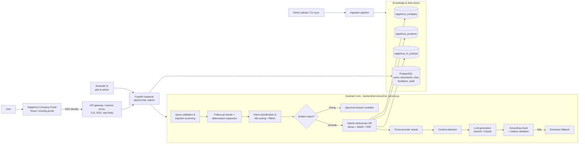
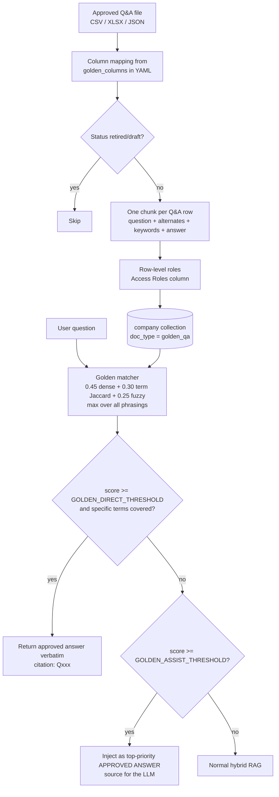
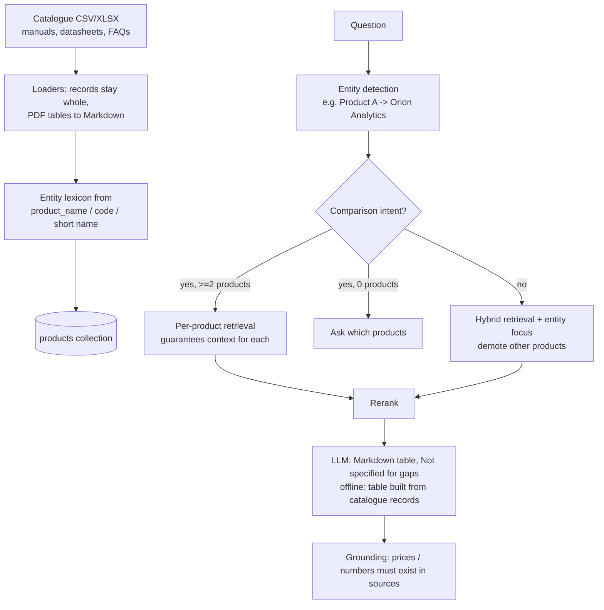
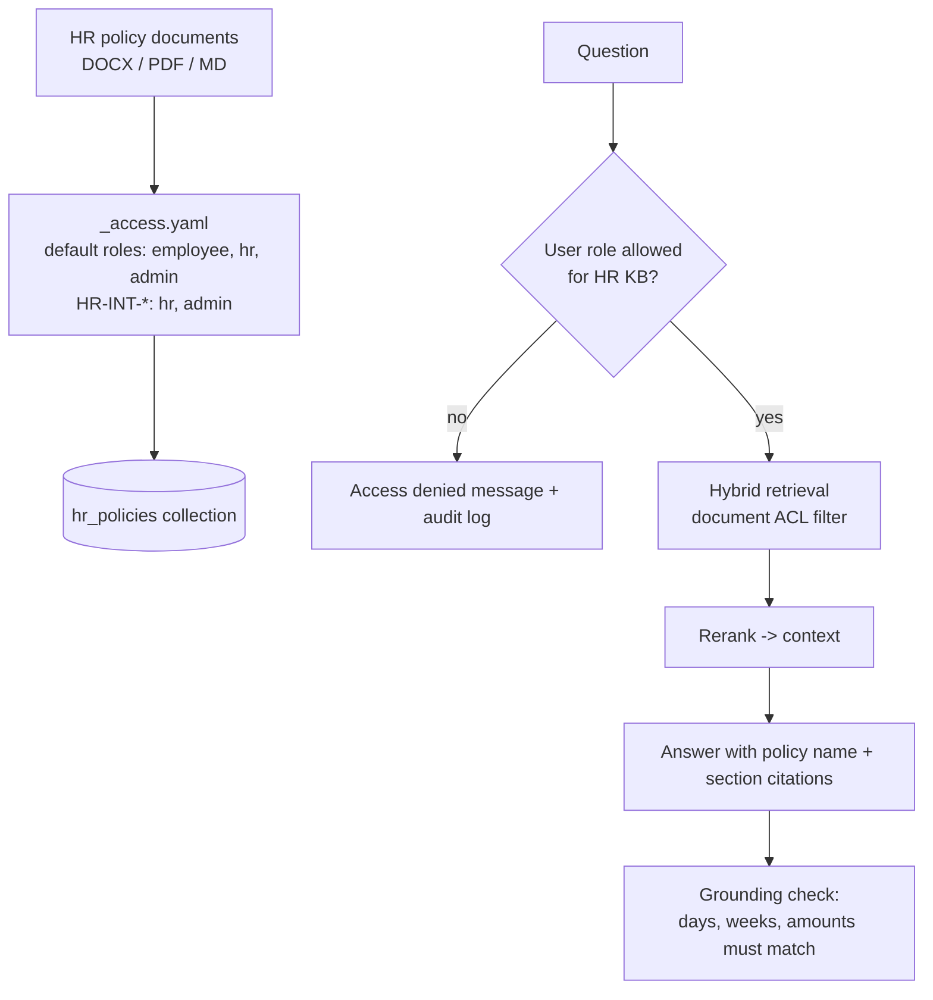
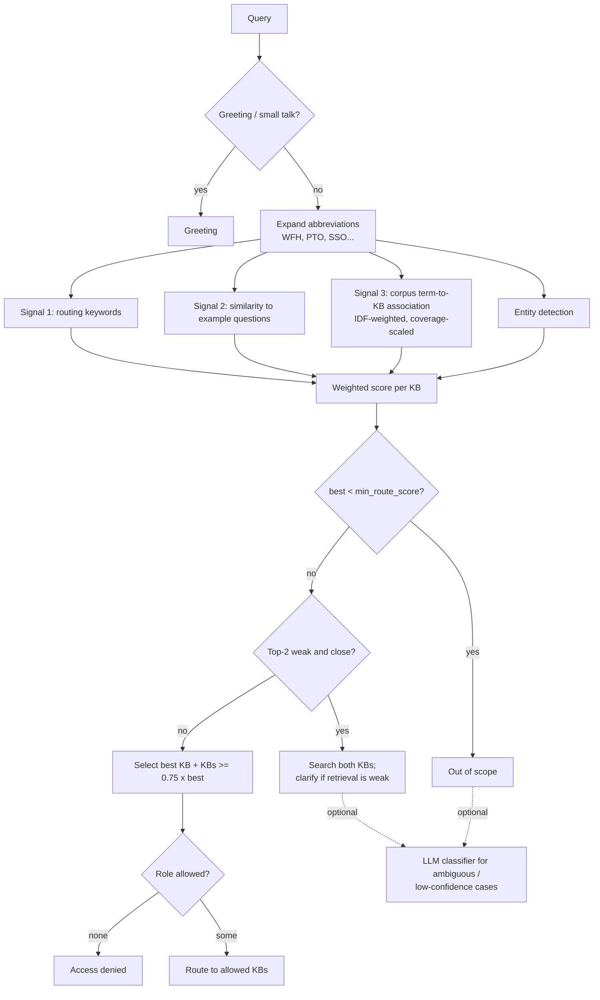
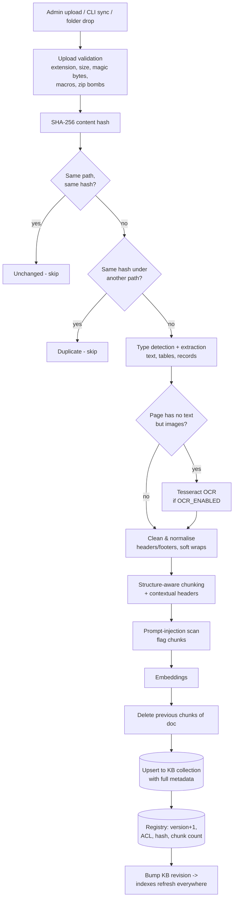
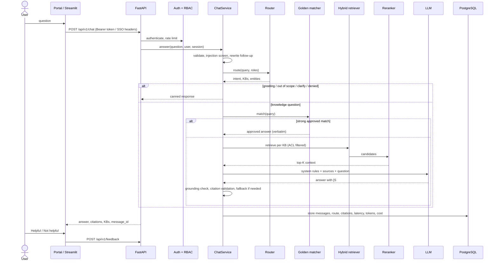

# Deliverables 2 & 3 — Architecture and Workflow Diagrams

Diagrams are written in Mermaid (render in GitHub, VS Code, or the pre-rendered SVGs in `docs/diagrams/`).

## 2.1 End-to-end architecture

**Key design choices**

* **One collection per knowledge base** keeps HR, product and company content physically separate; the router decides which collections are searched.
* **ACL is enforced in retrieval** (KB-level in the router, document-level and golden-row-level in the retriever), so restricted text never reaches the prompt.
* **Golden answers bypass the LLM** when the match is strong and covers the question's specific terms.
* **Everything is pluggable through `.env`**: LLM provider, embedding model, vector store, reranker, router mode, thresholds.

## 3.1 Company golden dataset workflow

## 3.2 Product knowledge base workflow

## 3.3 HR policies workflow

## 3.4 Query routing workflow

## 3.5 Document ingestion workflow

## 3.6 Complete chatbot execution

## Routing classifier trade-offs (prompt §5)

| Option | Pros | Cons | Used |
|---|---|---|---|
| Rules / keywords only | Fast, transparent | Brittle, needs maintenance | As one signal |
| Lightweight similarity (examples + corpus statistics) | No training data needed, adapts automatically when documents change, ~ms latency, free | Weaker on ambiguous phrasing | **Default (hybrid)** |
| Fine-tuned classifier | Accurate with labelled data | Needs labelled traffic and retraining | Later, from feedback logs |
| LLM classifier | Best semantic understanding, can ask clarifying questions | Latency + cost per query, non-deterministic | Only for ambiguous/low-confidence queries (`ROUTER_MODE=hybrid`), or always (`ROUTER_MODE=llm`) |
