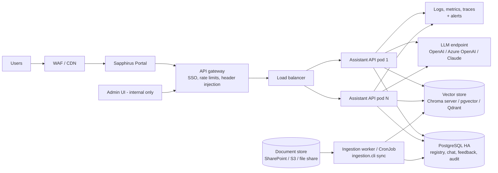

# Deliverable 12 — Production Deployment Architecture and Recommendations

## 1. Target architecture

## 2. Recommendations

**Compute & packaging**
* Use the provided `Dockerfile`/`docker-compose.yml` as the starting point; run the API with ≥ 2 replicas behind a load balancer. The API is stateless apart from the stores.
* Run ingestion as a separate worker/CronJob (`python -m ingestion.cli sync`) so large uploads never block chat traffic. Indexes in API pods refresh automatically via the KB revision counter.
* Serve the Streamlit admin console on the internal network only (or replace it with a portal admin page).

**Data stores**
* PostgreSQL (managed, HA, daily backups, PITR) via `DATABASE_URL`.
* For multiple API replicas, move vectors to a shared store: run Chroma in client/server mode or implement the `VectorStore` interface for **pgvector** (one fewer system to operate) or Qdrant/Azure AI Search. The embedded Chroma default is ideal for a single node/pilot.
* Keep source documents in a controlled repository (SharePoint/S3) and sync them into `knowledge_bases/` with the worker; keep the golden CSV in Git with review/approval (pull requests).

**Security**
* `APP_ENV=production` (refuses `AUTH_MODE=disabled`, requires `TOKEN_HASH_SECRET`).
* Secrets from a vault (Azure Key Vault / AWS Secrets Manager) injected as environment variables — never in images or Git.
* TLS everywhere; API only reachable from the gateway; strip client-supplied identity headers.
* Least privilege: HR KB limited to `employee/hr/admin`, restricted HR docs to `hr/admin`; review ACLs in `_access.yaml` during each dataset load.
* Data protection: choose an LLM endpoint with zero data retention / regional hosting (Azure OpenAI in-region or an enterprise agreement); or on-prem embeddings (`sentence_transformers`) if documents must not leave the network.
* Keep `BLOCK_PROMPT_INJECTION=true`; review audit events `chat_blocked`, `chat_access_denied`, `auth_failed`, `admin_access_denied`.
* Configure `CHAT_RETENTION_DAYS` per policy; the API purges on startup and `/admin/retention/purge` can be scheduled.

**Quality & cost**
* Start with `gpt-4o-mini`-class models (configurable); golden answers cost nothing; typical RAG prompts are ~1.5–3k tokens.
* Turn on `GROUNDING_MODE=llm` for HR if the extra fact-check call is acceptable.
* Cache embeddings of frequent questions at the gateway if traffic grows.
* Add the evaluation run to CI/CD; block releases on regression (see `06_evaluation.md`).

**Observability**
* Ship `logs/` (or stdout) to the central log platform; build dashboards from `chat_messages` (latency, tokens, cost, answer types, refusal rate) and `feedback`.
* Alerts: error rate, p95 latency > 8 s, refusal-rate spikes (missing content), LLM provider errors.

## 3. Go-live checklist

- [ ] Real datasets loaded and sample data purged (`10_dataset_replacement.md`)
- [ ] Evaluation on a held-out real question set meets the agreed gates
- [ ] Role mapping and ACLs signed off by HR and Security
- [ ] Penetration test of the API (auth bypass, injection, upload)
- [ ] Backups and restore tested (PostgreSQL + vector store + `knowledge_bases/`)
- [ ] Runbook for re-index, rollback (archived files in `data/archive/`), and LLM provider outage (extractive fallback is automatic)
